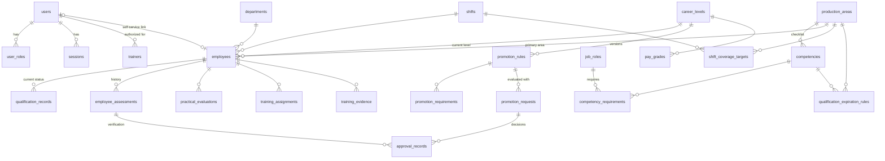

# Database schema

PostgreSQL, managed with Prisma. Source of truth: [`prisma/schema.prisma`](../prisma/schema.prisma). Migrations: `prisma/migrations/`.

| Table | Purpose | Key constraints |
|---|---|---|
| `users`, `user_roles`, `sessions` | Accounts, roles (many per user), hashed session tokens | unique email; unique (user, role) |
| `shifts`, `departments` | Shift A/B/C; organizational departments | unique code/name |
| `production_areas` | Departments/areas with their own checklist (Pre-Weigh, Mixing…) | unique code and name; `is_active`, `sort_order` |
| `competencies` | Checklist items; `is_critical`, `requires_evidence` | unique (area, name), unique code |
| `job_roles`, `competency_requirements` | Job titles and the competencies they require | unique (job, competency) |
| `employees` | Employee ID (`employee_number`), shift, area, job, supervisor, career level, `is_sample` | unique employee number; indexes on shift, area, supervisor, name |
| `qualification_records` | **Current** status per employee + competency; pending request; qualified/expiry dates; `version` for optimistic locking | unique (employee, competency) |
| `employee_assessments` | Every submitted rating (history); state moves only from PENDING to a final value | index (employee, competency, created) |
| `practical_evaluations` | Trainer's pass/fail and independent-operation check | |
| `trainers` | Trainer authorizations per area | unique (user, area) |
| `training_assignments` | Training with TWI step, trainer, due date, status, `version` | indexes on status, trainer, due date |
| `training_evidence` | Uploaded files (random stored name, SHA-256, MIME detected from content) | unique stored name |
| `qualification_expiration_rules` | Requalification months per area or competency | unique (area, competency) |
| `shift_coverage_targets` | Required qualified headcount per area and shift | unique (area, shift) |
| `career_levels` | Configurable progression levels | unique rank and name |
| `promotion_rules`, `promotion_requirements` | Version-controlled rule sets per level | unique (level, version) |
| `promotion_requests` | Recommendation, evaluation snapshot, status, decision and effective dates, `version` | |
| `approval_records` | **Append-only** decisions (qualification verification and promotion steps) | trigger blocks UPDATE/DELETE |
| `pay_grades`, `skill_premiums` | HR-only pay structure (amounts nullable, no defaults) | unique code/name |
| `audit_logs` | **Append-only** log of every change, export and sign-in | trigger blocks UPDATE/DELETE |

Notes:

- Employees are always identified by `id` plus the unique `employee_number`, never by name alone.
- "Expired" and "Not assessed" are worked out when records are read (from `expires_at` and job requirements), so an expired qualification stops counting immediately. No overnight job is needed.
- Every table has `created_at` / `updated_at` timestamps where they are meaningful, and foreign keys with explicit delete behavior.
